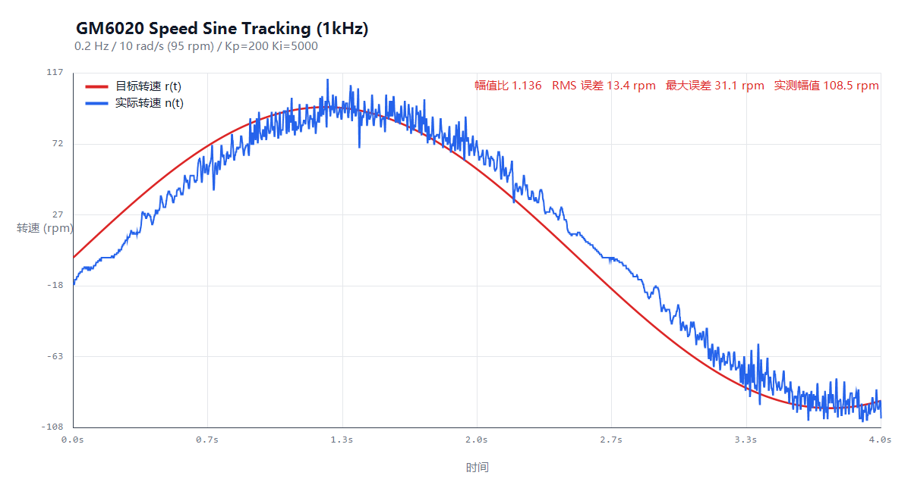
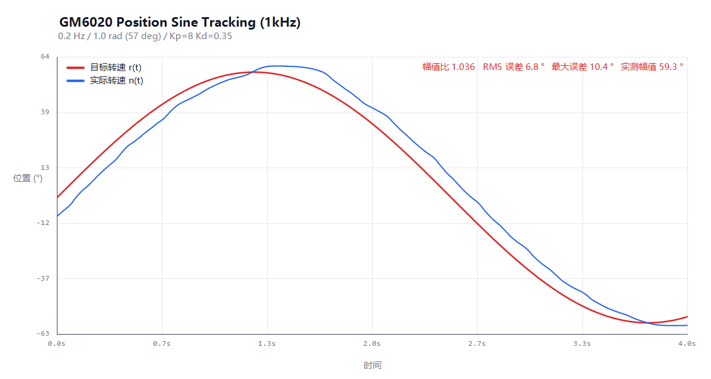

# GM6020 正弦速度/位置跟随控制

基于 STM32F407 + HAL 库的 RoboMaster GM6020 直流无刷电机控制程序。
实现电机**正弦速度曲线跟随**与**正弦位置曲线跟随**，并加入**独立看门狗(IWDG)保护**。

- 速度环实测：目标 0.2 Hz / 95 rpm，实际幅值 108.5 rpm，RMS 误差 13.4 rpm
- 位置环实测：目标 0.2 Hz / 57°，实际幅值 59.3°，RMS 误差 6.8°





## 功能

- **速度环**：电机转速跟随正弦速度曲线 `v_ref(t) = A_v · sin(2π·f·t)`（rad/s）
- **位置环**：电机角度跟随正弦位置曲线 `θ_ref(t) = A_p · sin(2π·f·t)`（rad）
- 两条曲线均**以 0 为中心摆动**，频率/幅值可配置
- 通过枚举变量 `CtrlMode` 在两种模式间切换
- **看门狗保护**：
  - 程序正常运行期间，1kHz 任务定时喂狗 `HAL_IWDG_Refresh(&hiwdg)`
  - CAN 反馈超时（>100ms，掉线/总线故障）→ 输出立即归零 + 停止喂狗 → 约 0.8s 后 IWDG 复位系统

## 硬件配置

| 项目 | 配置 |
|------|------|
| MCU | STM32F407IGHx |
| CAN | CAN1（PD0/PD1），1 Mbps |
| 电机 | GM6020，拨码 ID = 1 |
| 控制周期 | 1kHz（TIM6 中断，Prescaler=84-1, Period=1000-1） |
| 看门狗 | IWDG，Prescaler=64，Reload=400（约 0.8s 超时） |
| 电机驱动方式 | 电压模式，给定范围 ±30000（对应 ±24V 比例） |

## 文件结构

```
C_board_src/
├── ControlTask.h     # 控制任务对外接口 + 模式枚举
├── ControlTask.cpp   # 正弦跟随控制 + 看门狗保护(核心实现)
├── Gm6020.h/.cpp     # GM6020 CAN 协议封装(角度/速度/电流/温度)
├── Pid.h/.cpp        # 位置式 PID(含输出限幅 + 抗积分饱和)
└── main.h / can.h / iwdg.h  # CubeMX 生成(需你自己工程中的)

docs/                 # 实测波形图（1kHz 数据导出）
results/              # 实测原始数据 CSV（t, 目标值, 实际值, 误差）
```

## 可调参数

集中在 `ControlTask.cpp` 顶部（第 18~48 行）：

```cpp
volatile float g_sine_freq = 0.2f;   // 正弦频率 Hz
volatile float g_vel_amp   = 10.0f;  // 速度幅值 rad/s  (10 rad/s ≈ 95 rpm)
volatile float g_pos_amp   = 1.0f;   // 位置幅值 rad    (1 rad ≈ 57°)

static Pid g_velPid( 200.0f, 5000.0f, 0.0f, kAmpLimit, kMinAmp); // 速度环 PID
static Pid g_posPid(   8.0f,    0.0f, 0.35f,     6.0f,     -6.0f); // 位置环 PID
```

> 位置模式采用**串级控制**：位置环输出目标速度（限幅 ±6 rad/s），速度环作为内环执行。
> `g_mode` 决定上电默认模式：`CTRL_MODE_VEL`（速度）或 `CTRL_MODE_POS`（位置）。

## 实测结果

测试条件：GM6020 空载，24V 供电，速度模式 0.2Hz / 10 rad/s（≈95 rpm）正弦，
位置模式 0.2Hz / 1.0 rad（≈57°）正弦，1kHz 采样 4000 点（记录前已跳过上电启动的 10s 追赶过程）。

| 指标 | 速度环 | 位置环 |
|------|--------|--------|
| 目标幅值 | 95.5 rpm | 57.3° |
| 实测幅值 | 108.5 rpm | 59.3° |
| 幅值跟踪比 | 1.136 | 1.036 |
| RMS 误差 | 13.4 rpm | 6.8° |
| 最大绝对误差 | 31.1 rpm | 10.4° |

> 速度曲线的锯齿来自反馈分辨率：GM6020 回传的是整数 rpm，1ms 控制周期内
> 编码器只有十几个脉冲，±1~2 个脉冲就对应 ±8~15 rpm，因此 13 rpm 量级的
> RMS 已经接近量化噪声下限，主要不是控制误差。

### 调参过程（速度环，均为 10 rad/s 给定）

| Kp | Ki | 幅值比 | RMS 误差 | 说明 |
|----|----|--------|----------|------|
| 500 | 30 | 0.513 | 83 rpm | 积分时间 16s，比正弦周期还慢，幅值只跟到一半 |
| 500 | 2000 | 1.011 | 27.3 rpm | 幅值对了但相位滞后大，过零点推不动 |
| 500 | 5000 | 1.183 | 13.7 rpm | 积分够快，跟踪良好，幅值略过冲 |
| 700 | 5000 | 1.225 | 14.7 rpm | 比例偏大，过冲更明显 |
| **200** | **5000** | **1.131** | **12.5 rpm** | **最终取值：误差最小** |

关键结论：**幅值跟不上的病根是积分增益太小，不是比例增益太小**。
速度环的"电压→转速"增益约为 1/475（counts per rad/s），开环增益 = Kp × 该增益；
Ki 太小时积分项来不及在 5s 周期内补上电压缺口；而盲目加大 Kp 会让闭环在
1ms 采样 + CAN 传输延迟下产生高频振荡（实测 Kp=3000 时电机剧烈抖动）。

## 集成到你的工程

1. 把 `ControlTask.cpp` 加入编译（放在 `Core/Src` 或与 `Gm6020.cpp` 同目录）。
2. 在中断文件中转发回调：

```c
/* stm32f4xx_it.c 或 main.c */
void HAL_TIM_PeriodElapsedCallback(TIM_HandleTypeDef *htim) {
    if (htim->Instance == TIM6) {
        MainTask();          // 1kHz 控制入口
    }
}

void HAL_CAN_RxFifo0MsgPendingCallback(CAN_HandleTypeDef *hcan) {
    CAN_RxHeaderTypeDef rx;
    uint8_t data[8];
    if (hcan->Instance == CAN1) {
        HAL_CAN_GetRxMessage(hcan, CAN_RX_FIFO0, &rx, data);
        if (rx.IDE == CAN_ID_STD) {
            CanFeedbackCallback(rx.StdId, data);  // 转发给控制任务
        }
    }
}
```

3. 在 `main.c` 所有 `MX_XXX_Init()` 之后调用一次初始化：

```c
/* main.c, 在 while(1) 之前 */
ControlTaskInit();
```

4. 运行期切换模式（可选）：

```c
CtrlSetMode(CTRL_MODE_VEL);   // 速度正弦跟随
CtrlSetMode(CTRL_MODE_POS);   // 位置正弦跟随
CtrlSetSine(0.2f, 10.0f);     // 设置频率(Hz)与幅值
```

## 注意事项

- **CAN 接收中断必须使能**：仅配置 `MX_CAN1_Init()` 不会打开 `CAN1_RX0_IRQn`，
  必须调用 `HAL_NVIC_SetPriority(CAN1_RX0_IRQn, 5, 0)` + `HAL_NVIC_EnableIRQ(CAN1_RX0_IRQn)`，
  否则反馈帧堆在 FIFO 里（`CAN_RF0R` 的 FMP 只增不减），电机永远收不到反馈。
- **`.ioc` 里声明成 GPIO_Output 的引脚，代码里也要初始化**（PA4/PB0/PB14/PB15），
  否则 `MX_GPIO_Init()` 与工程声明不一致。
- 电压模式给定超过 ±25000 会进入饱和，调参时先把幅值设小（如 3~5 rad/s）再逐步加大。
